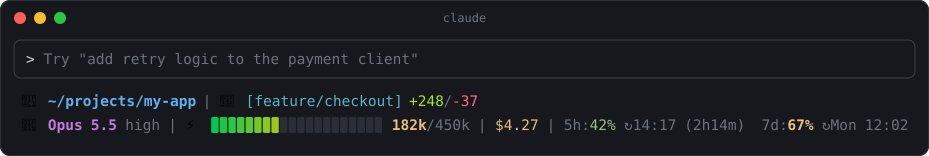
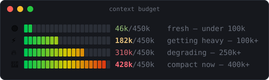

<div align="center">

# claude-statusline

**A two-line, colorful status line for [Claude Code](https://claude.com/claude-code)**
<br>
context budget at a glance · git state · cost · rate limits with reset times

<br>



<br>


</div>

---

## ✨ What you get

| | Field | Details |
|---|---|---|
| 📁 | **Directory** | Current working dir, `$HOME` shortened to `~` |
| 🌿 | **Git branch** | Branch name (or short SHA when detached) — clickable link to the branch on GitHub in terminals that support OSC 8 |
| ➕ | **Lines changed** | `+added/-removed` in this session |
| 🤖 | **Model & effort** | Model display name plus the current effort level |
| 🟢 | **Context bar** | 20-block truecolor gradient, green → yellow → red, with `tokens / budget` |
| 💲 | **Session cost** | Running total in USD |
| ⏱️ | **Rate limits** | 5-hour and 7-day usage in %, with local reset time and a countdown for the 5h window |

Every metric is traffic-light colored: **green** below 50 %, **yellow** below 80 %, **red** above.

## 🧠 Context budget, not context window

The bar is measured against a **450k-token working budget** — the point where answer
quality starts to slip in practice — rather than the model's full 1M window.
The emoji and the token count change color as you move through the zones:



When you see 🔥 it's time to wrap up the task; 🚨 means compact or start a fresh session.

## 🚀 Install

```bash
git clone https://github.com/alekseenkodev/claude-statusline.git ~/claude-statusline
bash ~/claude-statusline/install.sh
```

Restart Claude Code — done.

<details>
<summary><b>What does <code>install.sh</code> do?</b></summary>

<br>

1. Symlinks `statusline-command.sh` into `~/.claude/`.
2. Adds the `statusLine` block to `~/.claude/settings.json`, **keeping all your other settings**:

   ```json
   "statusLine": {
     "type": "command",
     "command": "bash ~/.claude/statusline-command.sh"
   }
   ```

3. Warns you if `jq` is missing.

</details>

### Requirements

- `bash`, `git`, `python3` (installer only)
- [`jq`](https://jqlang.org/) — `sudo apt install jq` or `brew install jq`
- A terminal with **truecolor** and emoji support for the gradient bar

## 🔄 Update

The script is symlinked, so updating is just:

```bash
git -C ~/claude-statusline pull
```

## 🎨 Customize

All knobs live at the top of the relevant section in `statusline-command.sh`:

| Variable | Default | Meaning |
|---|---|---|
| `CTX_BUDGET` | `450000` | Tokens that count as a "full" bar |
| `CTX_WARN` | `100000` | ⚡ yellow from here |
| `CTX_HIGH` | `250000` | 🔥 red from here |
| `CTX_ALARM` | `400000` | 🚨 alarm from here |
| `BAR_WIDTH` | `20` | Number of blocks in the bar |
| `C_*` | — | ANSI colors for each field |

Edits in the repo apply immediately — Claude Code re-runs the script on every refresh.

## 🗑️ Uninstall

```bash
rm ~/.claude/statusline-command.sh
```

Then remove the `statusLine` block from `~/.claude/settings.json`.
